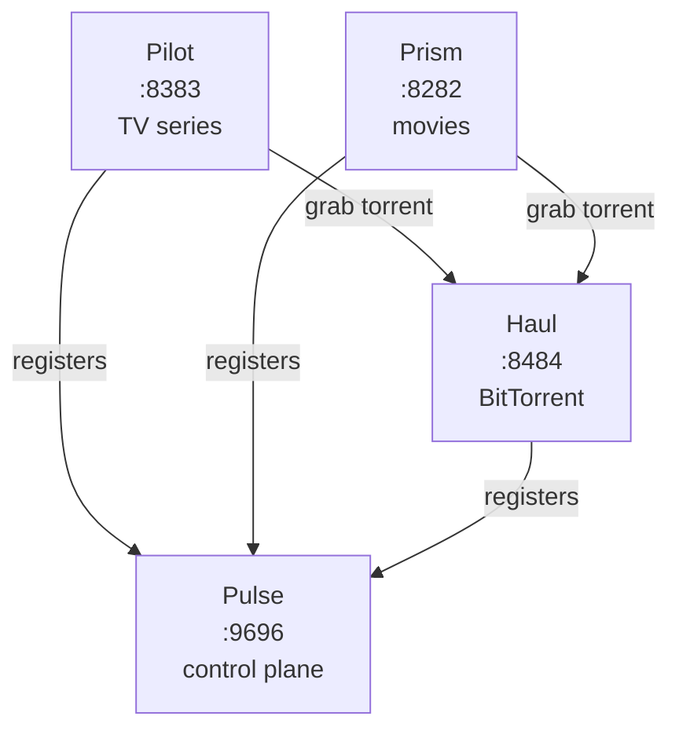

# Beacon Stack — Deploy

Docker Compose deployment for the full Beacon media management stack. One file, four services, one settings block to edit.

[](LICENSE)
[](https://docs.docker.com/get-docker/)
[](https://beaconstack.io)

[Quick start](#quick-start) · [Services](#services) · [Configuration](#configuration) · [Enabling VPN](#enabling-vpn) · [Upgrading from Postgres](#upgrading-from-postgres) · [Troubleshooting](#troubleshooting)

---

## What's in the stack

| Service | Purpose |
|---|---|
| **Pulse** | Control plane — central registry; manages indexers, quality profiles, download clients, and shared media-handling settings, and pushes them to every registered service |
| **Pilot** | TV series manager — monitors episodes, scores releases, and kicks off grabs |
| **Prism** | Movie collection manager — edition-aware release scoring, Radarr v3 API compatible |
| **Haul** | BitTorrent client with multi-level stall detection (catches dead torrents that look healthy on paper) and an in-band VPN-aware dashboard |
| _Gluetun_ | Optional — VPN tunnel for Haul. See [Enabling VPN](#enabling-vpn). |
| _FlareSolverr_ | Optional — Cloudflare challenge solver. See [FlareSolverr](#flaresolverr). |

Each service uses an embedded SQLite database in its `/config` volume. No shared Postgres, no init sidecars, no Docker secrets — the stack stands up with `docker compose up -d`.

### Data flow



Pulse is the hub. Pilot, Prism, and Haul all register with it on startup. Pilot and Prism pull indexers, quality profiles, download clients, and shared media-handling settings from Pulse on a 30-second sync (and immediately when Pulse pushes a change). Haul registers itself as a download client, so Pulse hands its address out to Pilot and Prism without any manual UI step. When Pilot or Prism grabs a release, the torrent goes to Haul.

---

## Quick start

**Prerequisites:** Docker Engine 24+ and Docker Compose v2.20+, 2 GB available RAM.

### 1. Clone

```bash
git clone https://github.com/beacon-stack/deploy.git
cd deploy
```

### 2. Edit the settings block

Open `docker-compose.yml`. The `x-settings` block at the top is the only part you need to touch:

```yaml
x-settings:
  tv:        &tv        /opt/media/tv:/tv                 # your TV directory
  movies:    &movies    /opt/media/movies:/movies         # your movies directory
  downloads: &downloads /opt/media/downloads:/downloads   # your downloads directory
  api-key:   &api-key   change-me-to-a-long-random-string # any long random string
  timezone:  &timezone  UTC                               # e.g. America/New_York
```

Change the part *left* of each colon to a real directory on your host, and replace the API key with something random (`openssl rand -hex 32` works). The `&name` markers are YAML anchors — leave them alone; they're how the value is reused further down the file.

> **Same filesystem rule.** All three host paths must live on the same filesystem. Beacon uses hardlinks + atomic moves for imports — across filesystems it falls back to slow file copies that double your disk usage. The simplest layout is one root with three subdirs (e.g. `/opt/media/{tv,movies,downloads}`).

That's the only required edit. Everything else in the file is plain, per-service Compose config you can read top to bottom.

### 3. Start

```bash
docker compose up -d
```

**Verify:**

```bash
docker compose ps
```

Everything should show `healthy`:

- Pulse → [http://localhost:9696](http://localhost:9696)
- Pilot → [http://localhost:8383](http://localhost:8383)
- Prism → [http://localhost:8282](http://localhost:8282)
- Haul → [http://localhost:8484](http://localhost:8484)

Pulse and Haul use the shared `api-key` from the settings block. Pilot and Prism generate their own on first run and store it in their SQLite DB (`./config/<app>/<app>.db`). Every key is visible in the UI under **Settings → General** with a **Regenerate** button — the same pattern Sonarr and Radarr use. External tools (Homepage, Home Assistant, Radarr v3 clients) read it from there.

---

## Services

| Service | Purpose | Default port | URL |
|---|---|---|---|
| Pulse | Control plane — indexers, quality profiles, shared settings | 9696 | [localhost:9696](http://localhost:9696) |
| Pilot | TV series management | 8383 | [localhost:8383](http://localhost:8383) |
| Prism | Movie collection management | 8282 | [localhost:8282](http://localhost:8282) |
| Haul | BitTorrent client | 8484 | [localhost:8484](http://localhost:8484) |

---

## Connecting the apps

Most of the wiring is automatic. On startup, Pilot, Prism, and Haul each register themselves with Pulse using the shared `api-key` from the settings block; you do **not** need to copy keys between UIs or add Haul as a download client by hand.

What flows automatically from Pulse to Pilot and Prism:

- **Indexers** — add a Torznab/Newznab indexer once in Pulse, and Pilot and Prism pick it up within 30 seconds (Pulse also fires a push hook on save, so it's usually instant).
- **Quality profiles** — managed centrally; profiles created in Pulse appear as read-only entries in Pilot/Prism. Local-only profiles still work for per-app overrides.
- **Download clients** — when Haul registers, Pulse auto-creates a download-client entry for it. Pilot and Prism sync that entry into their own download-client lists.
- **Shared media-handling settings** — colon replacement, rename-files toggle, extra file extensions. Set in Pulse, applied to Pilot and Prism on next sync.

The one thing you'll typically do in Pulse's UI on first run is open the Indexers page and add your Torznab/Newznab providers. Everything else is wired by the registration handshake.

> **VPN note.** When the VPN add-on is enabled, Haul shares Gluetun's network namespace and other services reach it as `vpn:8484` instead of `haul:8484`. Haul advertises this hostname during registration, so the auto-registered download-client entry resolves correctly without manual edits.

---

## Configuration

`docker-compose.yml` is meant to be **edited in place**. There is no required `.env` file. Optional features (VPN, FlareSolverr) are separate add-on files you layer on with `-f`.

### Media paths

The three paths in the settings block are the most important values. If you run on a NAS or split storage, edit the host side (left of the colon). Remember the [same-filesystem rule](#2-edit-the-settings-block).

### Ports

Each port-mapping line follows the pattern `"HOST:CONTAINER"`. Change the left number if another service on your host already uses 9696, 8383, 8282, or 8484. The container-side port (right number) doesn't change.

### Config storage

Each service's `/config` directory holds its SQLite database (`<app>.db`), settings, and per-app cached state. Defaults to `./config/<app>` next to the compose file. To move configs to a different volume (faster SSD, NAS share, etc.), edit the volume mount on the host side:

```yaml
volumes:
  - /var/lib/beacon/pulse:/config
```

### Timezone

`timezone` in the settings block. Change to any [IANA timezone](https://en.wikipedia.org/wiki/List_of_tz_database_time_zones) — applies to log timestamps and scheduled tasks across all services.

### API keys

`api-key` in the settings block is used as Pulse's and Haul's API key, and as the credential Pilot, Prism, and Haul present to Pulse when they register. Pilot and Prism generate their own keys on first run. Every key is shown under **Settings → General** in each UI. No init sidecar, no `/run/secrets/*` files — same model as Sonarr/Radarr.

To rotate the shared key, change it in the settings block and `docker compose up -d`.

### Docker socket (optional)

Pulse can show per-container CPU/memory on its dashboard and serve full container logs if it can read the Docker socket. This is off by default because the socket effectively grants root on the host. To enable, add to the `pulse` service:

```yaml
    environment:
      PULSE_DASHBOARD_DOCKER_SOCKET: /var/run/docker.sock
    volumes:
      - /var/run/docker.sock:/var/run/docker.sock:ro
    group_add:
      - "999"   # your host's docker group GID: getent group docker
```

### Watch folder for .torrent files (optional)

Add `HAUL_TORRENT_WATCH_DIR: /torrents-watch` to Haul's environment and bind-mount a host directory at `/torrents-watch`. Haul auto-adds any `.torrent` dropped there.

---

## Enabling VPN

VPN is off by default. To route Haul's torrent traffic through [Gluetun](https://github.com/qdm12/gluetun):

1. Open `docker-compose.vpn.yml` and fill in the `← EDIT` lines (provider, username, password, region).
2. Start the stack with both files:

   ```bash
   docker compose -f docker-compose.yml -f docker-compose.vpn.yml up -d
   ```

Defaults: PIA / OpenVPN / Netherlands. Gluetun supports [30+ providers](https://github.com/qdm12/gluetun-wiki/tree/main/setup/providers) — change `VPN_SERVICE_PROVIDER`, `VPN_TYPE`, and `SERVER_REGIONS` to match. For WireGuard, set `VPN_TYPE: wireguard` and add `WIREGUARD_PRIVATE_KEY` / `WIREGUARD_ADDRESSES` per the Gluetun wiki.

> **Tip:** to stop typing `-f` every time, create a file named `.env` next to the compose file containing
> `COMPOSE_FILE=docker-compose.yml:docker-compose.vpn.yml` — plain `docker compose up -d` then loads both.

**To disable** the VPN later: run `docker compose up -d` with only the base file (and `docker compose rm -sf vpn`). Haul reattaches to the normal network on its next start.

---

## FlareSolverr

[FlareSolverr](https://github.com/FlareSolverr/FlareSolverr) is a Cloudflare challenge solver for indexers behind Cloudflare bot protection. Most users don't need it.

```bash
docker compose -f docker-compose.yml -f docker-compose.flaresolverr.yml up -d
```

That's it — the add-on file also points Pulse at FlareSolverr, which it uses transparently for indexers that return Cloudflare challenges. Combine with the VPN by passing all three `-f` files.

---

## Updating

```bash
docker compose pull
docker compose up -d
```

Each service runs its own goose migrations on startup against its SQLite file.

---

## Upgrading from Postgres

If you're on a pre-SQLite Beacon Stack (one that ran a `postgres` container and `init-secrets` / `init-databases` sidecars), use `pg2sqlite` to migrate your data into the new SQLite files.

1. Stop the apps but **leave Postgres running** — it holds your data:

   ```bash
   docker compose stop pulse pilot prism haul
   ```

2. Pull the new images (which expect SQLite) and start them briefly so their goose migrations create the empty SQLite schema:

   ```bash
   docker compose pull pulse pilot prism haul
   docker compose up -d pulse pilot prism haul
   sleep 10
   docker compose stop pulse pilot prism haul
   ```

3. Run `pg2sqlite` against the still-up Postgres. It copies every row, table by table, with the right type coercion (`TIMESTAMPTZ`→RFC3339 TEXT, `JSONB`→TEXT, `BYTEA`→BLOB, `BOOLEAN`→0/1) and bumps the SQLite `sqlite_sequence` high-water marks so subsequent inserts continue past the imported IDs.

   ```bash
   docker run --rm --network deploy_default \
     -v "$PWD/config/pulse:/sqlite/pulse" \
     -v "$PWD/config/pilot:/sqlite/pilot" \
     -v "$PWD/config/prism:/sqlite/prism" \
     -v "$PWD/config/haul:/sqlite/haul" \
     ghcr.io/beacon-stack/pg2sqlite:latest \
       --pulse-pg "postgres://pulse:$(docker exec init-secrets cat /secrets/pulse.txt)@postgres:5432/pulse_db" \
       --pulse-sqlite /sqlite/pulse/pulse.db \
       --pilot-pg  "postgres://pilot:$(docker exec init-secrets cat /secrets/pilot.txt)@postgres:5432/pilot_db" \
       --pilot-sqlite  /sqlite/pilot/pilot.db \
       --prism-pg  "postgres://prism:$(docker exec init-secrets cat /secrets/prism.txt)@postgres:5432/prism_db" \
       --prism-sqlite  /sqlite/prism/prism.db \
       --haul-pg   "postgres://haul:$(docker exec init-secrets cat /secrets/haul.txt)@postgres:5432/haul_db" \
       --haul-sqlite   /sqlite/haul/haul.db
   ```

   It prints a per-table row count and exits non-zero on any mismatch.

4. Restart the apps on the populated SQLite files:

   ```bash
   docker compose up -d pulse pilot prism haul
   ```

5. Tear down the old Postgres + secrets volumes once you're confident the migration worked:

   ```bash
   docker compose down postgres init-secrets init-databases
   docker volume rm deploy_pgdata deploy_beacon-secrets
   ```

The `pg2sqlite` source lives at [`pg2sqlite/`](./pg2sqlite) in this repo if you want to inspect what it does before running it.

---

## Rebuilding pilot/prism from source (maintainer)

End users **don't need this section** — `docker compose pull` gives you a prebuilt image with the TMDB/Trakt keys already baked in.

If you're a maintainer rebuilding from source, the build needs `PILOT_TMDB_API_KEY` and `PRISM_TMDB_API_KEY` exported in your shell. The Dockerfiles enforce this — a build with empty keys aborts immediately rather than silently producing a 503-on-lookup binary.

Recommended layout: keep the keys in `~/.config/beacon/secrets.env` (outside any repo, mode 0600), source it before building. Example file:

```sh
# ~/.config/beacon/secrets.env  (chmod 600, NEVER commit)
export PILOT_TMDB_API_KEY=...
export PRISM_TMDB_API_KEY=$PILOT_TMDB_API_KEY
export PILOT_TRAKT_CLIENT_ID=...     # optional
```

Rebuild + redeploy via the dev compose (builds from sibling source repos):

```bash
. ~/.config/beacon/secrets.env
docker compose -f docker-compose.yml -f docker-compose.dev.yml build pilot prism
docker compose -f docker-compose.yml -f docker-compose.dev.yml up -d --force-recreate --no-deps pilot prism
```

If you forget the source step, the build fails with:

```
ERROR: TMDB_API_KEY is empty. Refusing to bake a keyless binary.
Set PILOT_TMDB_API_KEY in your shell before rebuilding.
```

Verify the new binary picked up the key:

```bash
docker logs pilot | grep "TMDB metadata client"
# expect: source=default  (key came from build-time bake-in)
```

---

## Troubleshooting

**A service never goes healthy**
- `docker compose logs <service>` names the problem. Common: another process already on the port; the bind-mounted media path doesn't exist; insufficient permissions to write to `./config/<app>`.

**Indexer or download client added in Pulse doesn't show up in Pilot/Prism**
- Pilot and Prism sync from Pulse on a 30-second poll, plus a push hook on save. Wait up to 30 seconds, or check `docker compose logs pilot` / `prism` for `pulse: indexer sync complete` lines. Synced entries appear with a Pulse marker and are read-only in the consumer's UI.

**Pilot or Prism never auto-registered Haul as a download client**
- Haul has to register with Pulse first (look for `pulse: auto-registered download-client service` in `docker compose logs pulse`). If Pulse logs show registration but Pilot/Prism still don't see it, force a sync with `docker compose restart pilot prism`.

**VPN won't connect** (when the VPN add-on is enabled)
- Check `OPENVPN_USER` / `OPENVPN_PASSWORD` in `docker-compose.vpn.yml`.
- Confirm the provider name matches Gluetun's expected value — see the [Gluetun wiki](https://github.com/qdm12/gluetun-wiki/tree/main/setup/providers).
- `docker compose logs vpn`

**`!reset` causing errors when enabling the VPN add-on**
- You're on Docker Compose < 2.20. Run `docker compose version` to check, then upgrade — `!reset` was added in Dec 2023 and is required for the VPN add-on to work correctly.

**Haul can't reach Pulse** (VPN add-on enabled)
- Haul shares Gluetun's network namespace. Gluetun's firewall allow-lists the compose network via `FIREWALL_OUTBOUND_SUBNETS=172.28.0.0/16`, and the add-on pins the network to that subnet.
- If `172.28.0.0/16` collides with something on your LAN, change both the `subnet` and `FIREWALL_OUTBOUND_SUBNETS` in `docker-compose.vpn.yml` to match, then `docker compose down && docker compose up -d`.

**Every indexer search fails right after a reboot** (`expected element type <rss> but have <error>`)
- Docker copies the host's DNS resolvers when a container is *created*. If the stack came up before the host had working DNS, containers have no upstream resolver until recreated: `docker compose up -d --force-recreate`. To make it permanent, add `dns: [1.1.1.1]` (or your LAN resolver) to each service.

**Port conflicts**
- If another host service uses 9696, 8383, 8282, or 8484, change the corresponding host port (left of the colon) in the relevant `ports:` block.

**Starting over**
- Stop the stack with `docker compose down`. Delete `./config/<app>/<app>.db` for any service you want to wipe, then `docker compose up -d`. Each service runs goose migrations to recreate an empty schema and generates a new API key on first run.

---

## Development

Clone this repo alongside `pulse/`, `pilot/`, `prism/`, `haul/` (i.e., all under one parent directory). `docker-compose.dev.yml` adds `build: ../<repo>` to each service so each `docker compose up -d --build` rebuilds against your local source. App configs and SQLite DBs land in `./config/<app>` next to the compose file (gitignored), so rebuilds don't wipe your UI settings.

```bash
docker compose -f docker-compose.yml -f docker-compose.dev.yml up -d --build
```

Rebuild a single service after local changes:

```bash
docker compose -f docker-compose.yml -f docker-compose.dev.yml build pilot
docker compose -f docker-compose.yml -f docker-compose.dev.yml up -d pilot
```

---

## Privacy

No telemetry, no analytics, no crash reporting, no update checks. Every Beacon app makes outbound connections only to services you explicitly configure: TMDB for metadata, your indexers, your download clients, your media servers, and (optionally) your VPN tunnel. Credentials stay in your local SQLite databases and bind-mounted config directories.

## License

MIT — see [LICENSE](LICENSE).
